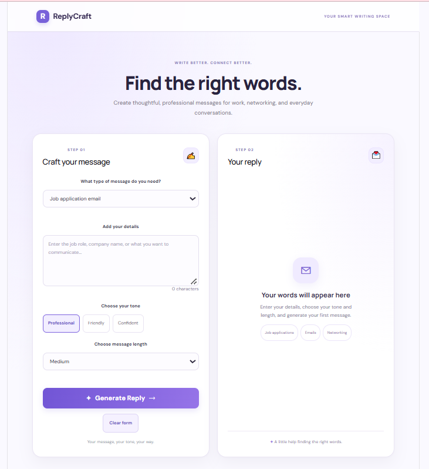
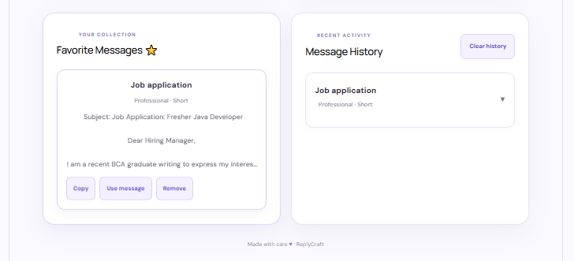

# ReplyCraft — AI-Powered Writing Assistant

ReplyCraft is a full-stack AI writing assistant that helps users create personalized messages for professional situations. It generates replies based on the selected purpose, tone, length, and user-provided details.

## Screenshots

### Main Interface



### Favorites and Message History



## Features

- **AI-Powered Reply Generation:** Generate messages using the Gemini API.
- **Multiple Purposes:** Create job application emails, recruiter follow-ups, thank-you emails, and LinkedIn messages.
- **Customizable Tone:** Choose Professional, Friendly, or Confident.
- **Adjustable Length:** Generate Short, Medium, or Detailed replies.
- **Copy to Clipboard:** Copy generated messages easily.
- **Favorites:** Save useful replies for later.
- **History:** View and reuse previously generated replies.
- **Responsive Interface:** Use the application on different screen sizes.

## Tech Stack

**Frontend**
- React
- JavaScript
- HTML5
- CSS3
- Vite

**Backend**
- Java
- Spring Boot
- Spring WebFlux WebClient
- REST API

**AI Integration**
- Google Gemini API

## Project Structure

```text
ReplyCraft/
├── replycraft/          # React frontend
│   ├── src/
│   ├── public/
│   └── package.json
├── replycraft-backend/  # Spring Boot backend
│   ├── src/
│   └── pom.xml
└── README.md
```

## Getting Started

### Prerequisites

- Node.js and npm
- Java JDK 21
- A Google Gemini API key

### 1. Clone the Repository

```bash
git clone https://github.com/harshalipatil2304/ReplyCraft.git
cd ReplyCraft
```

### 2. Run the Backend

Set the `GEMINI_API_KEY` environment variable to your Gemini API key before starting the backend.

Open a terminal in the `replycraft-backend` folder and run:

**Windows PowerShell:**

```powershell
$env:GEMINI_API_KEY="your-gemini-api-key"
.\mvnw.cmd spring-boot:run
```

Replace `your-gemini-api-key` with your own API key. Do not commit or share your actual key.

The backend runs at:

`http://localhost:8080`

### 3. Run the Frontend

Open another terminal and run:

```bash
cd replycraft
npm install
npm run dev
```

Open the local URL shown in your terminal, usually:

`http://localhost:5173`

## API Endpoint

| Method |  Endpoint    |       Description             |
|--------| ----------   |-------------------------------|
| POST   | `/api/reply` | Generates an AI-powered reply |

## What I Learned

- Building a React application with reusable UI components.
- Creating REST APIs using Spring Boot.
- Connecting a React frontend to a Java backend.
- Integrating an external AI API.
- Handling loading states, validation, and errors.
- Managing favorites and history using browser local storage.
- Keeping API credentials in environment variables.

## Future Improvements

- Deploy the frontend and backend.
- Add user authentication and cloud-based saved replies.
- Improve automated testing and error handling.

## Author

**Harshali Patil**

[GitHub Profile](https://github.com/harshalipatil2304)
